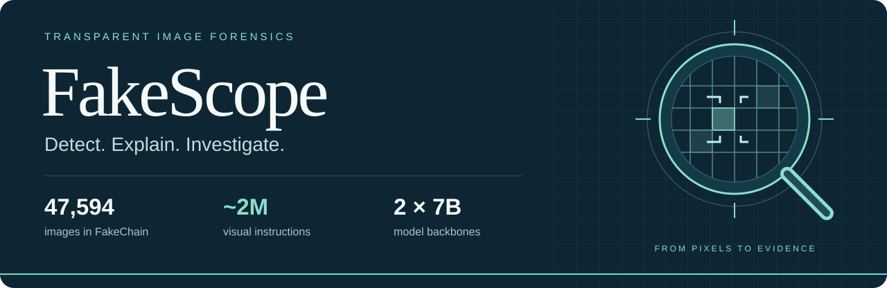
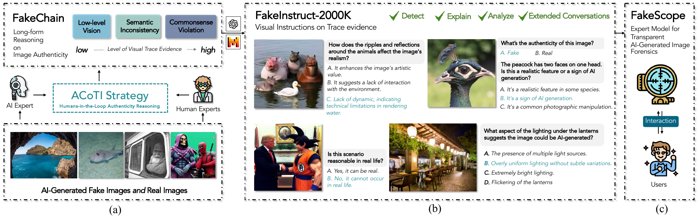
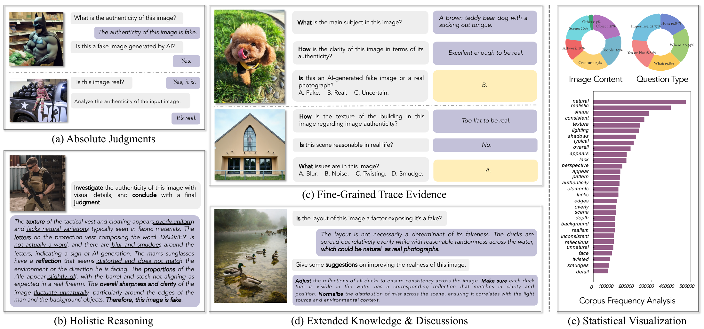
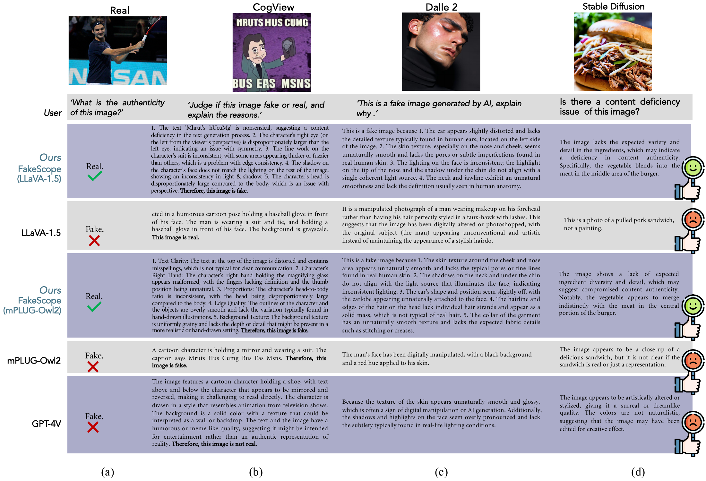

<div align="center">



<h1>FakeScope: Large Multimodal Expert Model for Transparent AI-Generated Image Forensics</h1>

<p>
  <a href="https://yixuanli423.github.io/">Yixuan Li</a><sup>1</sup>,
  <a href="https://scholar.google.com/citations?user=wBHHZcsAAAAJ&amp;hl=en">Yu Tian</a><sup>1</sup>,
  <a href="https://scholar.google.com/citations?user=P01gibMAAAAJ&amp;hl=en">Yipo Huang</a><sup>2</sup>,
  <a href="https://cse.sysu.edu.cn/en/node/2563">Wei Lu</a><sup>3</sup>,<br>
  <a href="https://www.cs.cityu.edu.hk/~shiqwang/">Shiqi Wang</a><sup>1,✉</sup>,
  <a href="https://personal.ntu.edu.sg/wslin/">Weisi Lin</a><sup>4</sup>,
  <a href="https://www.ic.unicamp.br/~rocha/">Anderson Rocha</a><sup>5</sup>
</p>
<p>
  <sup>1</sup>City University of Hong Kong &nbsp; <sup>2</sup>Chang’an University<br>
  <sup>3</sup>Sun Yat-Sen University &nbsp; <sup>4</sup>Nanyang Technological University<br>
  <sup>5</sup>University of Campinas &nbsp; <sup>✉</sup>Corresponding author
</p>

<p>
  <a href="https://arxiv.org/abs/2503.24267"></a>
  <a href="#model-zoo"></a>
  <a href="mailto:yixuan.li@bristol.ac.uk?subject=FakeInstruct%20training%20data%20access%20request"></a>
  <a href="LICENSE"></a>
</p>

<p>
  <a href="https://arxiv.org/abs/2503.24267"><b>Paper</b></a> ·
  <a href="#news"><b>🔥 News</b></a> ·
  <a href="#overview"><b>Overview</b></a> ·
  <a href="#model-zoo"><b>Models</b></a> ·
  <a href="#datasets"><b>Data</b></a> ·
  <a href="#getting-started"><b>Getting started</b></a> ·
  <a href="docs/inference.md"><b>Inference</b></a> ·
  <a href="#training"><b>Training</b></a> ·
  <a href="#results"><b>Results</b></a> ·
  <a href="#citation"><b>Citation</b></a>
</p>

</div>

## News

- 🔥🔥 **[2026] Supporting fact-checking in Brazil’s elections.** Through our collaboration with **Recod.ai at Unicamp**, FakeScope is used in **VigIA** to help verify AI-generated content during Brazil’s 2026 election campaign. Its visual-evidence explanations support journalists and human analysts alongside complementary detection tools. [VigIA methodology](https://www.agencialupa.org/observatorio/2026/08/11/como-o-vigia-monitora-conteudos-gerados-por-inteligencia-artificial-nas-eleicoes-de-2026/).
- 🔥 **[2026/09] FakeScope in the media!** **Superinteressante** and **Gazeta da Amazônia** highlight FakeScope’s explainable image forensics and its contribution to election monitoring. [Superinteressante](https://super.abril.com.br/tecnologia/na-eleicao-a-corrida-tambem-e-para-detectar-o-uso-de-ia/) · [Gazeta da Amazônia](https://gazetadaamazonia.com.br/04/09/2026/ia-nas-eleicoes-deteccao/).
- 🔥 **[2026/04] From research to real-world verification.** **Pesquisa FAPESP** reports how FakeScope helped analysts investigate a fabricated video by identifying distortions in a flag and around image edges. [Read the feature](https://revistapesquisa.fapesp.br/pesquisadores-brasileiros-desenvolvem-aplicacoes-para-combater-desinformacao/).

**[More news, media coverage, and real-world applications →](https://yixuanli423.github.io/fakescope-news.html)**

## Overview

**FakeScope brings detection and visual evidence into one conversation.** Given an image, it can assess authenticity, explain relevant visual cues, and answer questions about specific regions and artifacts. Its token soft-scoring method also converts authenticity-token logits into numerical scores, without additional training on numerical labels.

The project connects three components:

| FakeChain | FakeInstruct | FakeScope |
| :--- | :--- | :--- |
| **47,594 images** paired with structured forensic reasoning, collected through human–AI collaboration. | **~2 million visual instructions** covering authenticity judgments, reasoning, trace evidence, and extended discussions. | **Two 7B expert models**, built on mPLUG-Owl2 and LLaVA-v1.5 through visual instruction tuning. |

<p align="center">
  
  <br><sub>From visual trace evidence to instruction data and an interactive forensic expert.</sub>
</p>

### What can you ask?

| Capability | Example prompt |
| :--- | :--- |
| **Detect** | “What is the authenticity of this image?” |
| **Reason** | “Inspect this image carefully and evaluate its authenticity using visual evidence.” |
| **Explain** | “This is an AI-generated image. Explain the visual cues that support this label.” |
| **Analyze** | “Are the reflections consistent with the objects in this scene?” |
| **Discuss** | “Why might the texture in this region appear unnatural?” |

*In the explanation task, the authenticity label is supplied in the prompt. Detection and reasoning instead ask the model to infer it.*

## Model zoo

| Model | Backbone | Input resolution | Weights |
| :--- | :--- | :---: | :--- |
| **FakeScope-M** | mPLUG-Owl2 · 7B | 448 × 448 | [🤗 Hugging Face](https://huggingface.co/FakeScope/mplug_owl_2_fakeinstruct_v3) |
| **FakeScope-L** | LLaVA-v1.5 · 7B | 336 × 336 | [🤗 Hugging Face](https://huggingface.co/FakeScope/llava_1.5_fakeinstruct_v3) |

Both variants are trained on FakeInstruct. The paper describes a frozen vision encoder with fine-tuning of the language model and modality projector; see the [training notes](docs/training.md#manuscript-recipe-and-reproduction-scope) for differences in the supplied launchers. **-M** and **-L** follow the model names used in the paper.

Both model repositories require **access approval on Hugging Face**. Open the corresponding model page to request access, then authenticate to download the weights. See the [setup guide](docs/quickstart.md) for downloads and environments, then use the [public inference scripts](docs/inference.md) for image chat with both models or authenticity-logit export with FakeScope-L. The [training launchers](docs/training.md) are also available; the full benchmark evaluation harness is not included.

## Datasets

### FakeChain · structured forensic reasoning

FakeChain pairs **47,594 images** with authenticity labels and detailed visual-evidence descriptions: **23,797 AI-generated images** and **23,797 real images**. Synthetic images span **17 generators**, while real images come from DIV2K, RAISE, and ImageNet.

The **ACoTI** (*Anthropomorphic Chain-of-Thought Inference*) pipeline uses human-selected evidence categories and reasoning demonstrations to guide a teacher model through **Steer → Demonstrate → Enlighten**. The resulting explanations cover low-level visual cues, semantic inconsistencies, and commonsense violations.

### FakeInstruct · multimodal instruction tuning

| Instruction family | Approximate scale | Focus |
| :--- | ---: | :--- |
| Absolute authenticity judgments | 47K | Explicit real/fake decisions |
| Holistic reasoning | 95K | Connect visual evidence to an authenticity judgment |
| Fine-grained trace evidence | 715K | Open-ended and multiple-choice questions about local cues |
| Extended knowledge and discussions | 1,190K | Broader questions about artifacts and image realism |

*Counts are rounded as reported in the paper; the full collection is described as approximately 2M instructions.*

<p align="center">
  
</p>

**Request the training data:** To obtain the download link, please email [yixuan.li@bristol.ac.uk](mailto:yixuan.li@bristol.ac.uk?subject=FakeInstruct%20training%20data%20access%20request).

[Dataset construction and source coverage →](docs/datasets.md)

## Getting started

1. Choose **FakeScope-M** or **FakeScope-L** in the [model zoo](#model-zoo).
2. Request access on its Hugging Face page, then download the checkpoint after approval.
3. Follow the [setup guide](docs/quickstart.md) to install the matching backbone runtime.
4. Run the [inference scripts](docs/inference.md) to chat about an image or export authenticity scores.

The paper evaluates inference on a **single NVIDIA A100 40GB**. This is the reported evaluation setup, not a minimum VRAM requirement.

| Guide | What it covers |
| :--- | :--- |
| [Environment setup](docs/quickstart.md) | Model access, downloads, and backbone environments |
| [Requirements](requirements/README.md) | Separate LLaVA / mPLUG-Owl2 dependency profiles for inference and training |
| [Run inference](docs/inference.md) | Image chat, single-image scoring, batch manifests, and output formats |
| [Train FakeScope](docs/training.md) | Training launchers, data preparation, and hyperparameters |
| [Method notes](docs/method.md) | ACoTI, instruction tuning, and token soft-scoring |
| [Evaluation results](docs/results.md) | Benchmark definitions, model comparisons, and evaluation scope |

## Results

### Detection and forensic analysis

Results below are reported in the paper. **Detect** is accuracy (%) on FakeClass; **Interpret**, **Reason**, and **Analyze** are the paper’s aggregated transparency scores; **Attribute** is accuracy (%) on FakeBench<sup>MCQ</sup>. Higher is better within each column.

| Model | Detect ↑ | Interpret ↑ | Reason ↑ | Analyze ↑ | Attribute ↑ |
| :--- | ---: | ---: | ---: | ---: | ---: |
| mPLUG-Owl2 | 71.78 | 0.423 | 0.296 | 0.368 | 65.97 |
| **FakeScope-M** | **99.68** | 0.638 | **0.614** | 0.540 | **78.50** |
| LLaVA-v1.5 | 57.70 | 0.468 | 0.311 | 0.394 | 61.83 |
| **FakeScope-L** | 98.30 | **0.640** | 0.610 | **0.553** | 77.74 |

### Generalization and in-the-wild detection

| Model | Unseen generators · mAP ↑ | WildRF + SynthWildX · mAP ↑ |
| :--- | ---: | ---: |
| FakeScope-M | **95.67** | **88.49** |
| FakeScope-L | 94.68 | 78.46 |

*All values are percentages. “Unseen generators” follows the unseen subset in the paper’s generalization table; the in-the-wild column is the reported mean across the six source/generator subsets of WildRF and SynthWildX. These are different evaluation settings.*

[More results and evaluation details →](docs/results.md)

<details>
<summary><b>Qualitative examples from the paper</b></summary>

<p align="center">
  
</p>

These are the paper’s illustrative examples, not outputs generated by this repository during setup.

</details>

## Training

FakeScope uses supervised visual instruction tuning on FakeInstruct for **one epoch**, with a peak learning rate of **2 × 10⁻⁵**, cosine decay, and bfloat16 precision. The paper reports training on eight NVIDIA H20-NVLink 98GB GPUs, taking approximately 34 hours.

The public training launchers follow Q-Instruct’s **after** strategy and preserve the supplied FakeScope settings. Both support configurable paths and `--dry-run` command previews.

| FakeScope-L | FakeScope-M |
| :--- | :--- |
| [LLaVA-v1.5 training script](scripts/train/fake_instruct_llava_v1.5_7b.sh) | [mPLUG-Owl2 training script](scripts/train/fake_instruct_mplugowl2.sh) |

[Training setup, data preparation, and configuration notes →](docs/training.md)

## Scope and limitations

FakeScope targets AI-generated image forensics. Its textual rationales are **post-hoc explanations for human inspection**, rather than proof of the model’s internal causal decision process. Soft scores reflect the selected token logits; they should not be interpreted as a guaranteed, calibrated probability for arbitrary images. Performance may change with new generators, image processing, and distribution shifts. Face manipulation and super-resolution are treated as out-of-distribution settings in the paper.

## Citation

If you use FakeScope, FakeChain, or FakeInstruct in your research, please cite:

```bibtex
@misc{li2025fakescope,
  title         = {FakeScope: Large Multimodal Expert Model for Transparent AI-Generated Image Forensics},
  author        = {Yixuan Li and Yu Tian and Yipo Huang and Wei Lu and Shiqi Wang and Weisi Lin and Anderson Rocha},
  year          = {2025},
  eprint        = {2503.24267},
  archivePrefix = {arXiv},
  primaryClass  = {cs.CV},
  url           = {https://arxiv.org/abs/2503.24267}
}
```

## License and acknowledgments

Repository code is covered by the existing [MIT license](LICENSE). Model weights, training images, and dataset annotations remain subject to the terms supplied with those resources and their upstream sources; the code license does not replace those terms.

We thank the teams behind [LLaVA](https://github.com/haotian-liu/LLaVA), [mPLUG-Owl2](https://github.com/X-PLUG/mPLUG-Owl/tree/main/mPLUG-Owl2), and [Q-Instruct](https://github.com/Q-Future/Q-Instruct). This repository’s presentation and training workflow build on Q-Instruct; the supplied training launchers were adapted from its **after** strategy.

For questions, please [open an issue](https://github.com/Yixuanli423/FakeScope/issues) or contact [Yixuan Li](mailto:yixuan.li@bristol.ac.uk).
